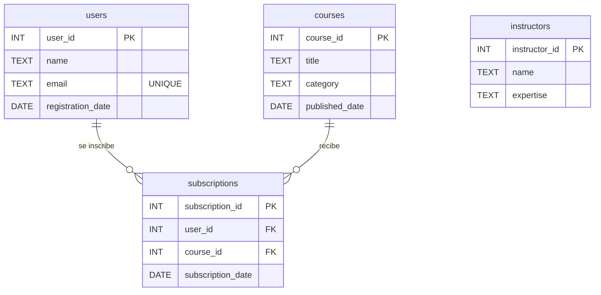
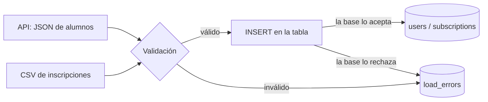

# EduCursos: un mismo esquema en cuatro motores SQL

Práctica de la Lecture 1 del Módulo 2 de Henry Data Science. La base de EduCursos (alumnos, cursos, instructores e inscripciones) se escribe en cuatro motores SQL, para que la plataforma quede flexible frente a decisiones de infraestructura.

## Estrategia tecnológica

| Motor | Rol en EduCursos | Rama |
|---|---|---|
| SQL Server | Desarrollo y enseñanza inicial | `sqlserver` |
| PostgreSQL | Producción: robusto y con buena compatibilidad analítica | `postgresql` |
| SQLite | Prototipos y pruebas de concepto | `sqlite` |
| MySQL | Opción de integración | `mysql` |

Cada motor se trabajó en su propia rama, en paralelo, y después se unieron todas en `main`. Los scripts se ejecutaron y compararon en DBeaver.

## Estructura del repositorio

```
educursos/
├── sqlserver/    educursos_sqlserver.sql   + load_errors_sqlserver.sql
├── postgresql/   educursos_postgresql.sql  + load_errors_postgresql.sql
├── mysql/        educursos_mysql.sql       + load_errors_mysql.sql
├── sqlite/       educursos_sqlite.sql      + load_errors_sqlite.sql
├── data/         inscripciones_nuevas.csv, actualizaciones_api.json
├── carga/        cargar_datos.py, consultas_trazabilidad.sql, requirements.txt
└── README.md
```

## Modelo de datos



`subscriptions` resuelve la relación muchos a muchos entre alumnos y cursos.

### Decisiones de diseño

El script original (`online_learning_platform_mssql.sql`) venía de un conversor automático y tenía tablas sin claves ni restricciones, con todos los textos como `NVARCHAR(MAX)` y las fechas guardadas como texto. En esta versión se corrigió:

- **Claves primarias** en las cuatro tablas.
- **Claves foráneas** de `subscriptions` hacia `users` y `courses`.
- **`UNIQUE`** en el email del alumno y en el par alumno-curso (nadie se inscribe dos veces al mismo curso).
- **Fechas como `DATE`** en lugar de texto, salvo en SQLite (ver la tabla de diferencias).
- **Textos con largo máximo** en lugar de `MAX`.

`instructors` queda sin relación con `courses` porque los datos de origen no indican qué instructor dicta cada curso. Es un punto a completar en una próxima versión del modelo.

## Diferencias entre los dialectos

| Aspecto | SQL Server | PostgreSQL | MySQL | SQLite |
|---|---|---|---|---|
| Texto | `NVARCHAR` | `VARCHAR` | `VARCHAR` | `TEXT` |
| Fechas | `DATE` | `DATE` | `DATE` | `TEXT` (AAAA-MM-DD) |
| Texto con acentos | Prefijo `N'...'` | Unicode por defecto | `CHARACTER SET utf8mb4` | Unicode por defecto |
| Crear la base | `CREATE DATABASE` | `CREATE DATABASE` y reconectar | `CREATE DATABASE` + `USE` | Es un archivo `.db` |
| Claves foráneas | Siempre activas | Siempre activas | Activas, pero solo escritas al final de la tabla | Requieren `PRAGMA foreign_keys = ON` |
| Autoincremento (referencia) | `IDENTITY(1,1)` | `GENERATED ALWAYS AS IDENTITY` | `AUTO_INCREMENT` | `INTEGER PRIMARY KEY` |

Las claves foráneas se escriben al final de cada tabla (`FOREIGN KEY (...) REFERENCES ...`) en los cuatro scripts, porque es la única forma que funciona igual en todos los motores.

## Cómo ejecutar

| Motor | Pasos |
|---|---|
| SQL Server | `docker start sql_server_2022`. En DBeaver, conectada a `educursos`, ejecutar el script. |
| PostgreSQL | Contenedor `postgres_educursos` (puerto 5432). Ejecutar `CREATE DATABASE educursos;`, conectarse a esa base y ejecutar el script. |
| MySQL | Contenedor `mysql_educursos` (puerto 3306). Ejecutar el script: crea la base solo. |
| SQLite | En DBeaver, nueva conexión SQLite con un archivo `educursos.db` nuevo, y ejecutar el script. |

## Validación

Cada script termina con las mismas dos consultas, para comparar los motores entre sí:

1. **Conteo de filas:** users 3, instructors 2, courses 3, subscriptions 4.
2. **Inscripciones con nombre del alumno y del curso** (un `JOIN` entre las tres tablas): 4 filas, iguales en los cuatro motores.

## Parte 3: carga y validación de datos

EduCursos recibe actualizaciones todas las semanas: alumnos nuevos desde una API (en formato JSON) e inscripciones en archivos CSV. Antes de entrar a la base, cada registro se valida, y los que fallan no se descartan en silencio: quedan guardados en una tabla de errores.

> Los archivos de `data/` son **datos de prueba generados para esta práctica**. Incluyen errores a propósito, para comprobar que la validación funciona.

### Flujo de la carga



La validación tiene dos capas:

1. **En Python, antes de llegar a la base:** campos obligatorios completos y fechas con formato `AAAA-MM-DD` válido.
2. **En la base, con sus restricciones:** claves foráneas (el alumno y el curso tienen que existir), `UNIQUE` (sin emails ni inscripciones repetidas) y claves primarias.

### Tabla de errores: `load_errors`

| Columna | Qué guarda |
|---|---|
| `error_id` | Identificador del error |
| `source` | De qué archivo o API vino el registro |
| `record` | El registro rechazado, tal como llegó (en JSON) |
| `error_message` | Por qué se rechazó |
| `loaded_at` | Cuándo ocurrió |

Así cada carga es **trazable**: se puede saber qué entró, qué no y por qué, y corregir el dato en el origen. Hay una versión de la tabla para cada motor (`load_errors_<motor>.sql`).

### Automatización con Python y SQLAlchemy

`carga/cargar_datos.py` lee las dos fuentes, valida y carga. Cada registro se inserta en **su propia transacción** (`engine.begin()`): si falla, se deshace solo y la carga sigue con el siguiente.

La conexión se crea con `create_engine`, que es lo único que cambia entre motores. El script usa PostgreSQL, el motor de producción; para otro motor alcanza con cambiar la dirección de conexión (hay ejemplos en el código). Este esquema también facilita sumar más adelante un framework web como Flask o FastAPI.

La contraseña de la base **no está en el código**: se lee de una variable de entorno, para no subirla a GitHub.

### Cómo ejecutarla

Desde la carpeta `educursos`, con PostgreSQL encendido:

1. En DBeaver, conectada a `educursos` en PostgreSQL, ejecutar `postgresql/educursos_postgresql.sql` y después `postgresql/load_errors_postgresql.sql`.
2. En la Terminal:

```bash
python3 -m venv .venv
source .venv/bin/activate
pip install -r carga/requirements.txt
export EDUCURSOS_DB_PASSWORD='tu_contraseña'
python carga/cargar_datos.py
```

3. Revisar el resultado con `carga/consultas_trazabilidad.sql`.

### Resultado esperado

```
actualizaciones_api.json: 2 cargados, 2 enviados a load_errors
inscripciones_nuevas.csv: 3 cargados, 4 enviados a load_errors
  users: 5 filas
  subscriptions: 7 filas
  load_errors: 6 filas
```

| Origen | Registro | Motivo del rechazo | Capa |
|---|---|---|---|
| API | Pedro Sosa | Email repetido (`ana@example.com`) | Base: `UNIQUE` |
| API | Valeria Paz | Falta el email | Python |
| CSV | Inscripción 1007 | El alumno 9 no existe | Base: clave foránea |
| CSV | Inscripción 1008 | Ana ya está inscripta en el curso 101 | Base: `UNIQUE` |
| CSV | Inscripción 1009 | Fecha `2023-13-45` | Python |
| CSV | Inscripción 1011 | Falta el alumno | Python |

El script no está pensado para correrse dos veces seguidas sobre los mismos datos: en la segunda vuelta todo iría a `load_errors` por claves repetidas. Para repetir la prueba desde cero, volver a ejecutar los dos scripts SQL del paso 1.
