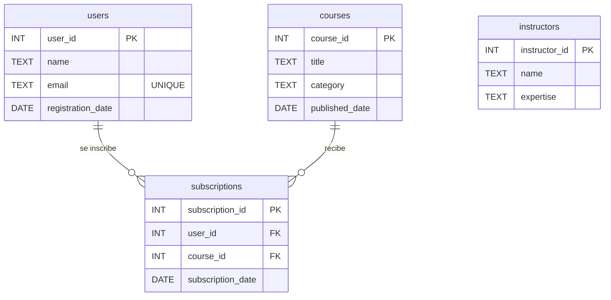

# EduCursos: un mismo esquema en cuatro motores SQL

Práctica de la Lecture 1 del Módulo 2 de Henry Data Science. La base de EduCursos (alumnos, cursos, instructores e inscripciones) se escribe en cuatro motores SQL, para que la plataforma quede flexible frente a decisiones de infraestructura.

## Estrategia tecnológica

| Motor | Rol en EduCursos | Rama |
|---|---|---|
| SQL Server | Desarrollo y enseñanza inicial | `sqlserver` |
| PostgreSQL | Producción: robusto y con buena compatibilidad analítica | `postgresql` |
| SQLite | Prototipos y pruebas de concepto | `sqlite` |
| MySQL | Opción de integración | `mysql` |

Cada motor se trabajó en su propia rama, en paralelo, y después se unieron todas en `main`. Los scripts se ejecutaron y compararon en DBeaver.

## Estructura del repositorio

```
educursos/
├── sqlserver/educursos_sqlserver.sql
├── postgresql/educursos_postgresql.sql
├── mysql/educursos_mysql.sql
├── sqlite/educursos_sqlite.sql
└── README.md
```

## Modelo de datos



`subscriptions` resuelve la relación muchos a muchos entre alumnos y cursos.

### Decisiones de diseño

El script original (`online_learning_platform_mssql.sql`) venía de un conversor automático y tenía tablas sin claves ni restricciones, con todos los textos como `NVARCHAR(MAX)` y las fechas guardadas como texto. En esta versión se corrigió:

- **Claves primarias** en las cuatro tablas.
- **Claves foráneas** de `subscriptions` hacia `users` y `courses`.
- **`UNIQUE`** en el email del alumno y en el par alumno-curso (nadie se inscribe dos veces al mismo curso).
- **Fechas como `DATE`** en lugar de texto, salvo en SQLite (ver la tabla de diferencias).
- **Textos con largo máximo** en lugar de `MAX`.

`instructors` queda sin relación con `courses` porque los datos de origen no indican qué instructor dicta cada curso. Es un punto a completar en una próxima versión del modelo.

## Diferencias entre los dialectos

| Aspecto | SQL Server | PostgreSQL | MySQL | SQLite |
|---|---|---|---|---|
| Texto | `NVARCHAR` | `VARCHAR` | `VARCHAR` | `TEXT` |
| Fechas | `DATE` | `DATE` | `DATE` | `TEXT` (AAAA-MM-DD) |
| Texto con acentos | Prefijo `N'...'` | Unicode por defecto | `CHARACTER SET utf8mb4` | Unicode por defecto |
| Crear la base | `CREATE DATABASE` | `CREATE DATABASE` y reconectar | `CREATE DATABASE` + `USE` | Es un archivo `.db` |
| Claves foráneas | Siempre activas | Siempre activas | Activas, pero solo escritas al final de la tabla | Requieren `PRAGMA foreign_keys = ON` |
| Autoincremento (referencia) | `IDENTITY(1,1)` | `GENERATED ALWAYS AS IDENTITY` | `AUTO_INCREMENT` | `INTEGER PRIMARY KEY` |

Las claves foráneas se escriben al final de cada tabla (`FOREIGN KEY (...) REFERENCES ...`) en los cuatro scripts, porque es la única forma que funciona igual en todos los motores.

## Cómo ejecutar

| Motor | Pasos |
|---|---|
| SQL Server | `docker start sql_server_2022`. En DBeaver, conectada a `educursos`, ejecutar el script. |
| PostgreSQL | Contenedor `postgres_educursos` (puerto 5432). Ejecutar `CREATE DATABASE educursos;`, conectarse a esa base y ejecutar el script. |
| MySQL | Contenedor `mysql_educursos` (puerto 3306). Ejecutar el script: crea la base solo. |
| SQLite | En DBeaver, nueva conexión SQLite con un archivo `educursos.db` nuevo, y ejecutar el script. |

## Validación

Cada script termina con las mismas dos consultas, para comparar los motores entre sí:

1. **Conteo de filas:** users 3, instructors 2, courses 3, subscriptions 4.
2. **Inscripciones con nombre del alumno y del curso** (un `JOIN` entre las tres tablas): 4 filas, iguales en los cuatro motores.
